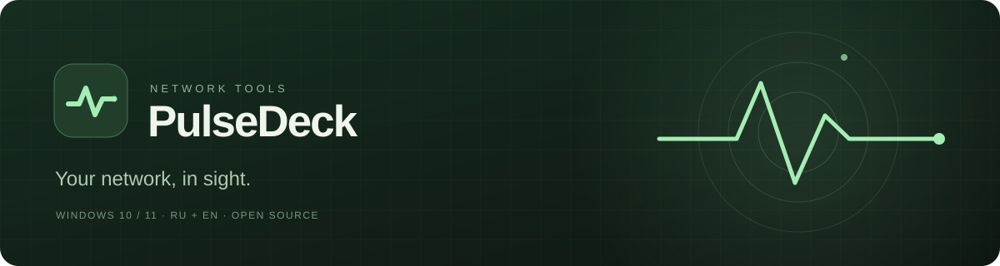
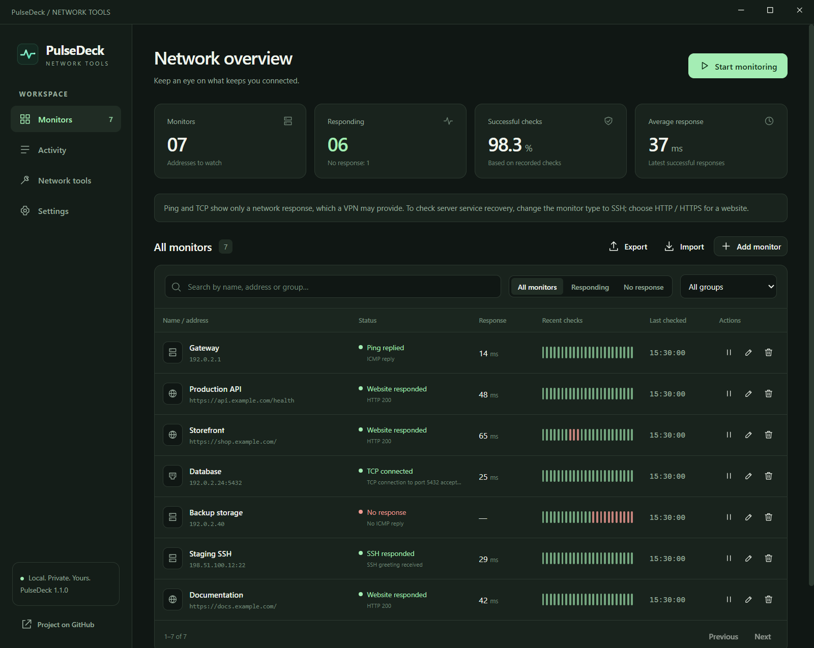
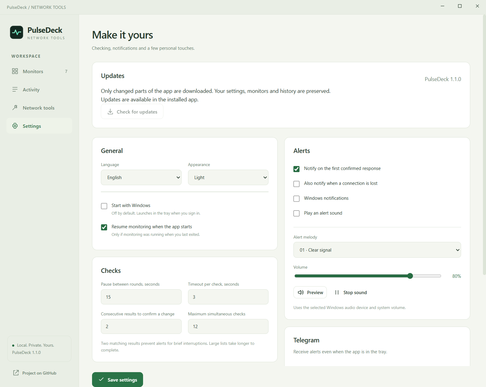
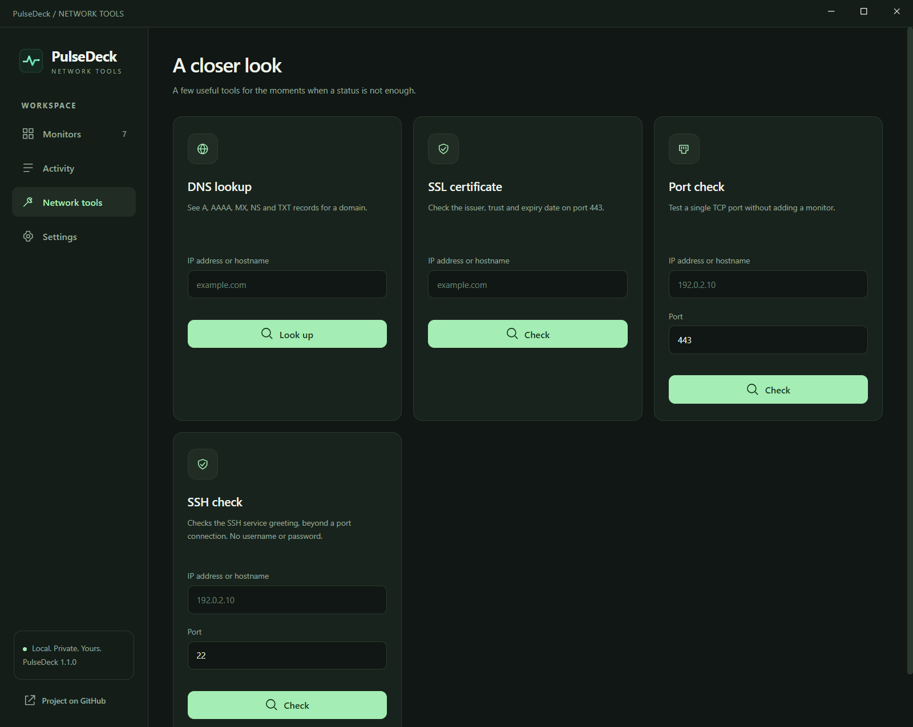
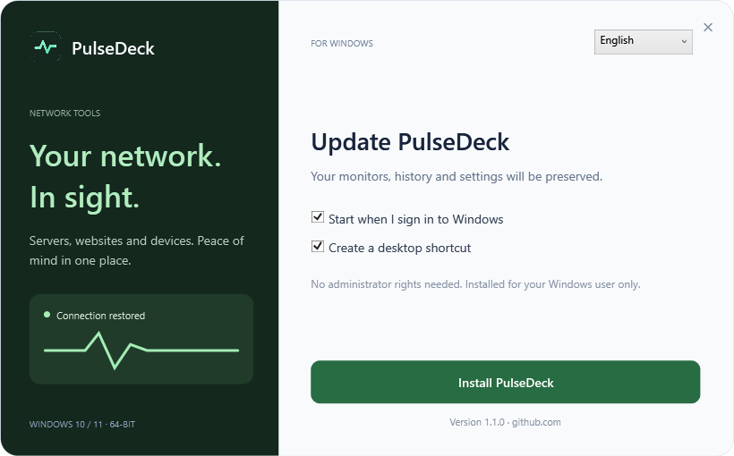

<a href="https://github.com/dmitriiavdeev/pulsedeck-network/releases/download/v1.1.0/PulseDeck-Setup-1.1.0-x64.exe"><strong>Download for Windows</strong></a> · <a href="README.md">Русский</a>

Windows 10 and 11 · 64-bit · Free

**PulseDeck monitors your servers, websites and network devices.** Add the addresses you care about and get notified when a connection drops or comes back.

- Add addresses individually or import a list, organize them into groups and find them with search. No fixed limit on the number of monitors.
- Response charts and event history show when a problem started and when connectivity returned.
- Telegram and desktop notifications, plus 20 alert sounds with adjustable volume. Each notification channel can be switched off independently.
- SSH service checks for server recovery. In-app updates download only the changed parts.
- Look up domain records, inspect security certificates and check open ports.

English and Russian interfaces, light and dark themes. Monitoring continues in the Windows system tray when you close the window. You can enable startup with Windows in settings.

More screenshots

Screenshots show example addresses and demonstration check history.

[User guide](docs/guide.en.md) · [Report an issue](https://github.com/dmitriiavdeev/pulsedeck-network/issues) · [For developers](docs/development.en.md)

Open source · [MIT license](LICENSE) · [dmitriiavdeev](https://github.com/dmitriiavdeev)
