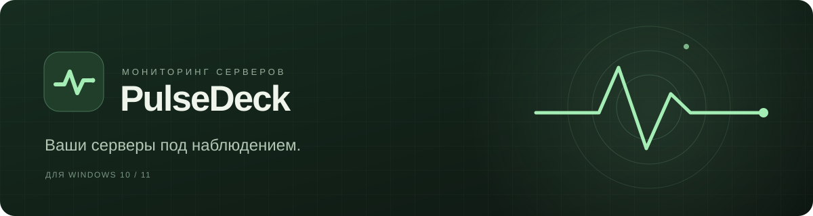
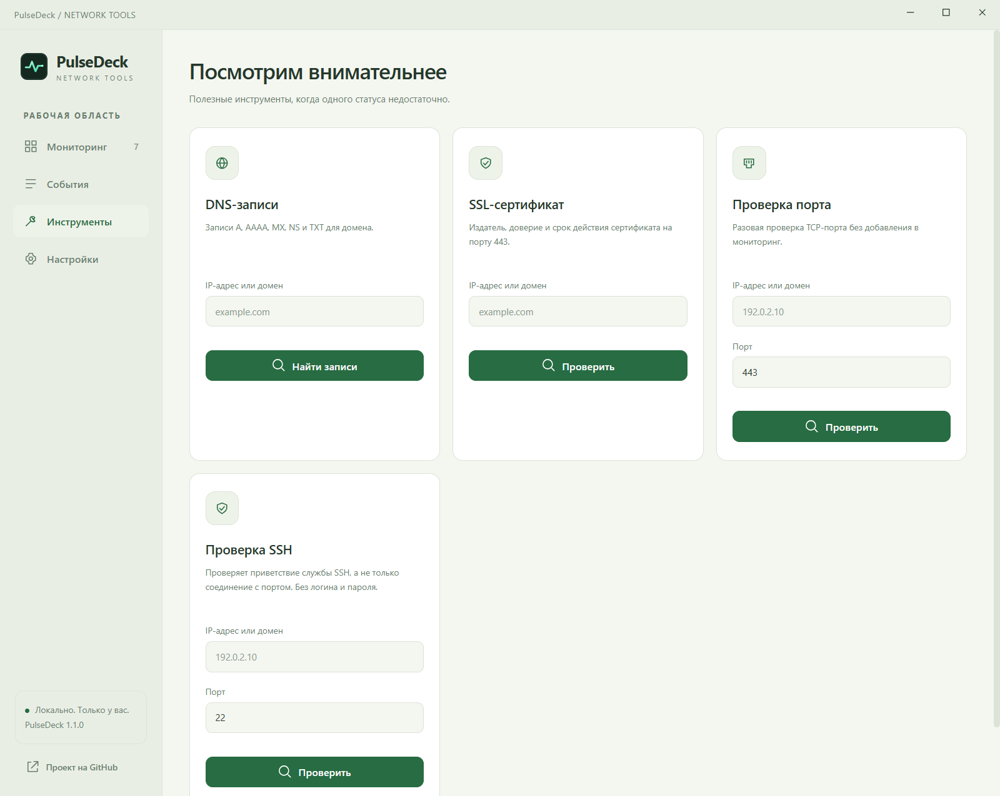
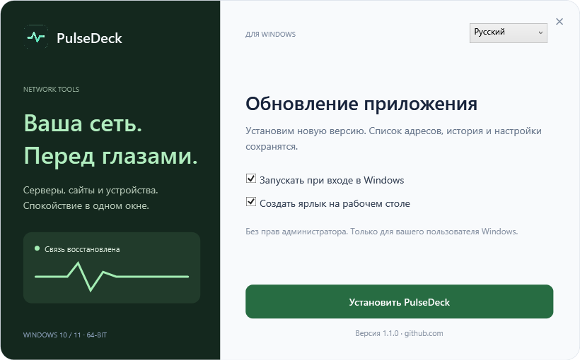

<a href="https://github.com/dmitriiavdeev/pulsedeck-network/releases/download/v1.1.0/PulseDeck-Setup-1.1.0-x64.exe"><strong>Скачать для Windows</strong></a> · <a href="README.en.md">English</a>

Windows 10 и 11 · 64-разрядная версия · Бесплатно

**PulseDeck следит за доступностью серверов, сайтов и сетевых устройств.** Добавьте нужные адреса и получайте уведомления, когда связь пропадает или восстанавливается.

- Адреса по одному или списком, группы и быстрый поиск. Без фиксированного лимита количества адресов.
- Графики отклика и история событий: видно, когда возникла проблема и когда связь вернулась.
- Уведомления в Telegram и на рабочем столе, 20 звуковых сигналов с регулировкой громкости. Каждый вид уведомлений можно отключить.
- Проверка ответа SSH для наблюдения за восстановлением сервера. Обновление приложения с загрузкой только изменившихся частей.
- Проверка доменных записей, сертификатов безопасности и доступности портов.

Русский и английский интерфейс, светлая и тёмная темы. При закрытии окна мониторинг продолжается в области уведомлений Windows. Автозапуск можно включить в настройках.

Ещё скриншоты

На скриншотах показаны демонстрационные адреса и история проверок.

[Как пользоваться](docs/guide.ru.md) · [Сообщить о проблеме](https://github.com/dmitriiavdeev/pulsedeck-network/issues) · [Для разработчиков](docs/development.ru.md)

Открытый исходный код · [Лицензия MIT](LICENSE) · [dmitriiavdeev](https://github.com/dmitriiavdeev)
