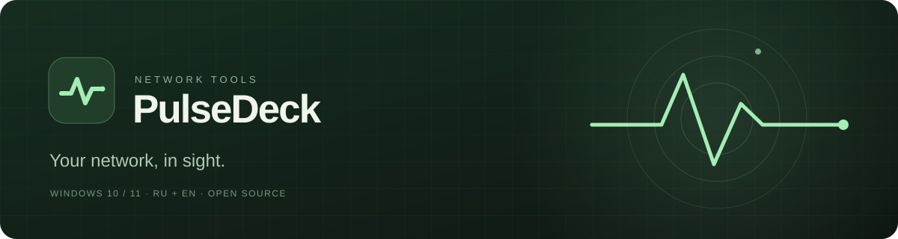
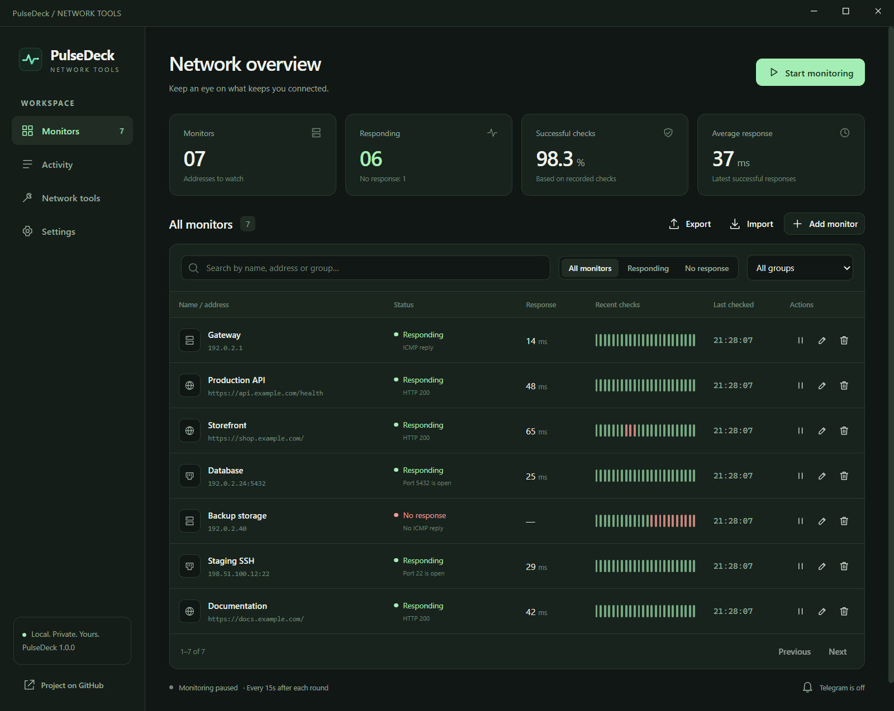
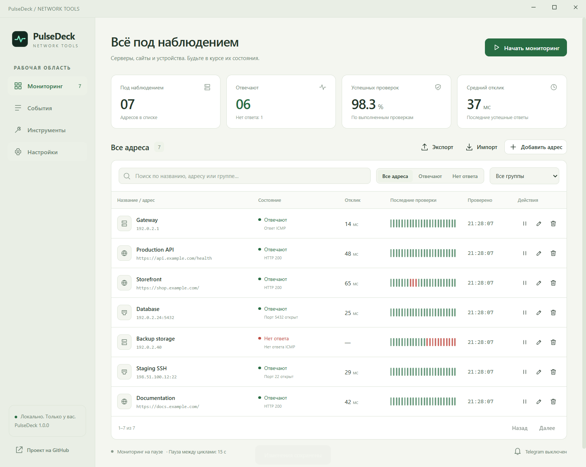
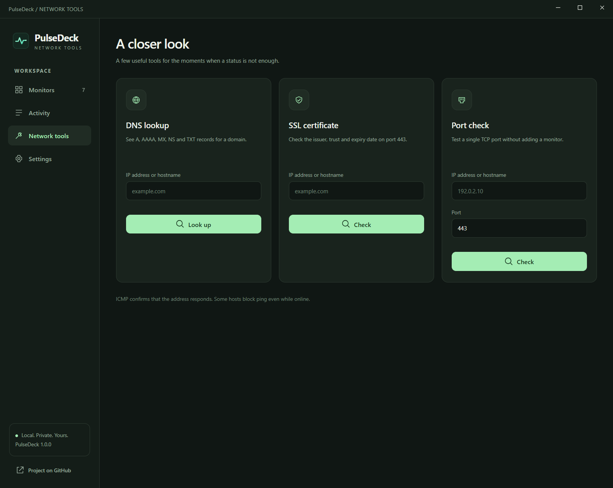
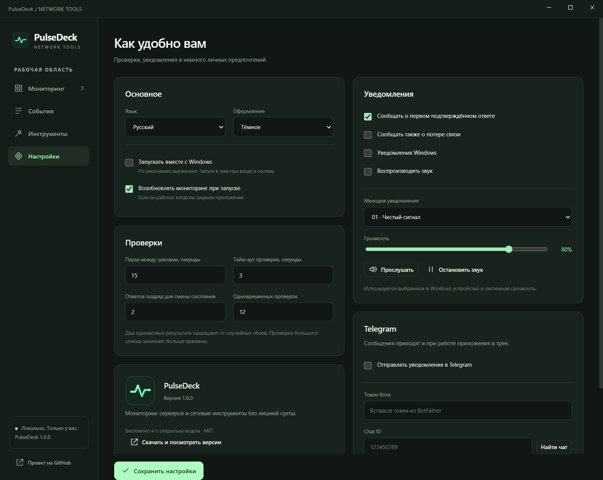
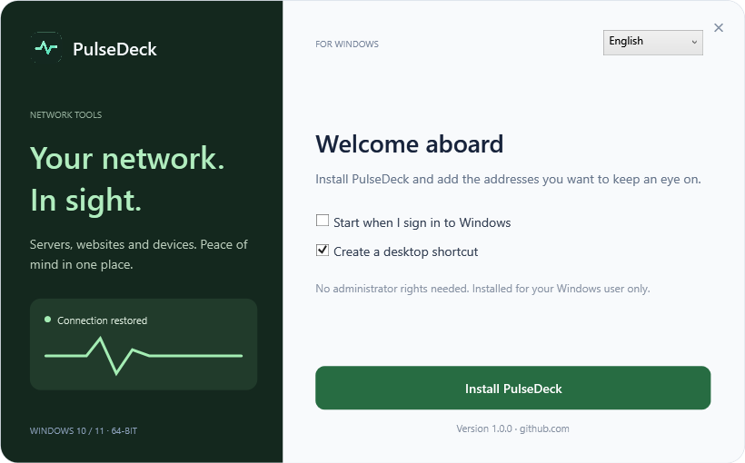

<p align="center"></p>

<p align="center"><a href="https://github.com/dmitriiavdeev/pulsedeck-network/releases/latest"><strong>Download for Windows / Скачать для Windows</strong></a> · <a href="#русский">Русский</a> · <a href="#english">English</a></p>

## English

**PulseDeck is a desktop home for server monitoring and network tools.** Watch IP addresses, ports and websites. Get notified when a connection returns.

- Ping, TCP and HTTP/HTTPS monitors, groups, search and bulk import. No fixed monitor-count limit; checks use a bounded worker pool.
- Response charts, successful-check ratio, activity history and CSV export.
- Telegram, Windows popups and 20 original alert melodies with volume control. Each channel has its own switch.
- DNS lookup, SSL certificate inspection and a quick port check.
- English and Russian, light and dark themes, system tray and optional Windows startup. Startup is off by default.



Download the **Setup .exe** from [Releases](https://github.com/dmitriiavdeev/pulsedeck-network/releases/latest), install and add your addresses. Windows 10/11, x64. No Node.js or administrator rights needed. Builds are currently unsigned, so Windows may display a publisher warning.

Closing the window keeps checks running in the tray. Use **Quit** in the tray menu to exit completely. Your computer must be on and awake. Ping confirms an ICMP reply, TCP confirms an open port, and HTTP checks the response status; none of these proves that an entire service works correctly.

For Telegram, create a dedicated bot using [BotFather](https://t.me/BotFather), press Start in its chat, then enter the token in Settings and click **Find chat**. Select the chat, send a test and save. The token is encrypted for your Windows account and is excluded from exports. No account or telemetry.

## Русский

**PulseDeck — мониторинг серверов и сетевые инструменты в одном Windows-приложении.** Следите за IP-адресами, портами и сайтами. Узнавайте о восстановлении связи сразу после подтверждения ответа.

- Ping, TCP и HTTP/HTTPS, группы, поиск и массовое добавление. Без фиксированного лимита адресов, с ограничением одновременной нагрузки.
- Графики отклика, доля успешных проверок, история событий и экспорт CSV.
- Telegram, всплывашки Windows и 20 мелодий с регулировкой громкости. Всё отключается независимо.
- DNS-записи, проверка SSL-сертификатов и TCP-портов.
- Русский и английский, две темы, работа в трее. Автозапуск по умолчанию выключен.



Скачайте **Setup .exe** в [разделе Releases](https://github.com/dmitriiavdeev/pulsedeck-network/releases/latest), установите приложение и добавьте адреса. Нужна Windows 10/11 x64. Node.js и права администратора не требуются. Установщик пока без цифровой подписи, поэтому Windows может показать предупреждение об издателе.

Крестик скрывает окно в трей. Для полного закрытия используйте **Выйти** в меню трея. Компьютер должен быть включён и не спать. Ping подтверждает ответ ICMP, TCP — доступность порта, HTTP — статус ответа, но не полноценную работу всего сервиса.

Для Telegram создайте отдельного бота через [BotFather](https://t.me/BotFather), нажмите Старт в чате с ним и вставьте токен в настройках. Нажмите **Найти чат**, отправьте тест и сохраните настройки. Токен зашифрован для вашей учётной записи Windows и не попадает в экспорт. Аккаунт и телеметрия отсутствуют.

<details><summary>More screenshots / Ещё скриншоты</summary>





Screenshots use example addresses and demonstration history. / На скриншотах примерные адреса и демонстрационная история.
</details>

## Development / Разработка

Windows x64, Node.js 22+, .NET Framework 4.8 (included in current Windows 10/11).

```sh
npm ci
node scripts/prepare.mjs
npm test
npm run test:ui
npm start
```

Commit verified source before `npm run build`. The custom installer includes an uninstaller, per-user shortcuts, optional startup and payload hash verification. Release files go to `release/`; they are not committed. A release manifest records the full Git SHA and SHA-256 hashes.

UI strings: `app/ui/translations.json`. Monitor engine: `app/engine.cjs`. Network checks: `app/probes.cjs`. Windows installer: `installer/`. User settings and history: `%APPDATA%\PulseDeck\pulsedeck.json`.

History retains the last 120 checks per monitor and 1,000 activity entries; lifetime sample counters are retained. Confirmed changes require two matching results by default. Telegram retries failed deliveries; in rare ambiguous network failures a message can be delivered twice. Unsatisfied delivery retries remain queued across restarts, up to 200 messages. Switching bot or chat clears the queue.

MIT © 2026 [dmitriiavdeev](https://github.com/dmitriiavdeev). Electron and its bundled components retain their own licenses in the installed distribution.
